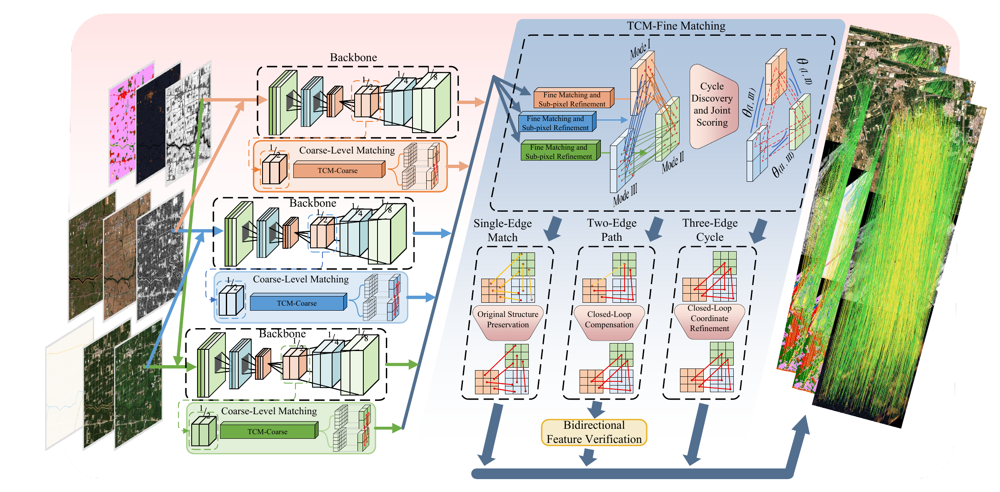

# TCMNet

TCMNet is a tri-modal image matching framework that combines coarse-to-fine correspondence estimation with cycle-guided refinement. TCM-Coarse refines coarse similarities through local neighborhood consensus, while TCM-Fine integrates subpixel matching, cycle discovery, correspondence completion, and coordinate refinement. Bidirectional feature verification checks completed matches, enabling the three image pairs to share complementary matching evidence.

[Model Weights](https://drive.google.com/drive/folders/1x6OR6h2YQ2_P42r3Uymww6ImwQ2jAk4n?usp=drive_link) · [Aligned Multimodal Dataset](https://drive.google.com/drive/folders/1ZcMLCYTXG9qonKbDh38WqY-wvFzNrOZo?usp=drive_link)

